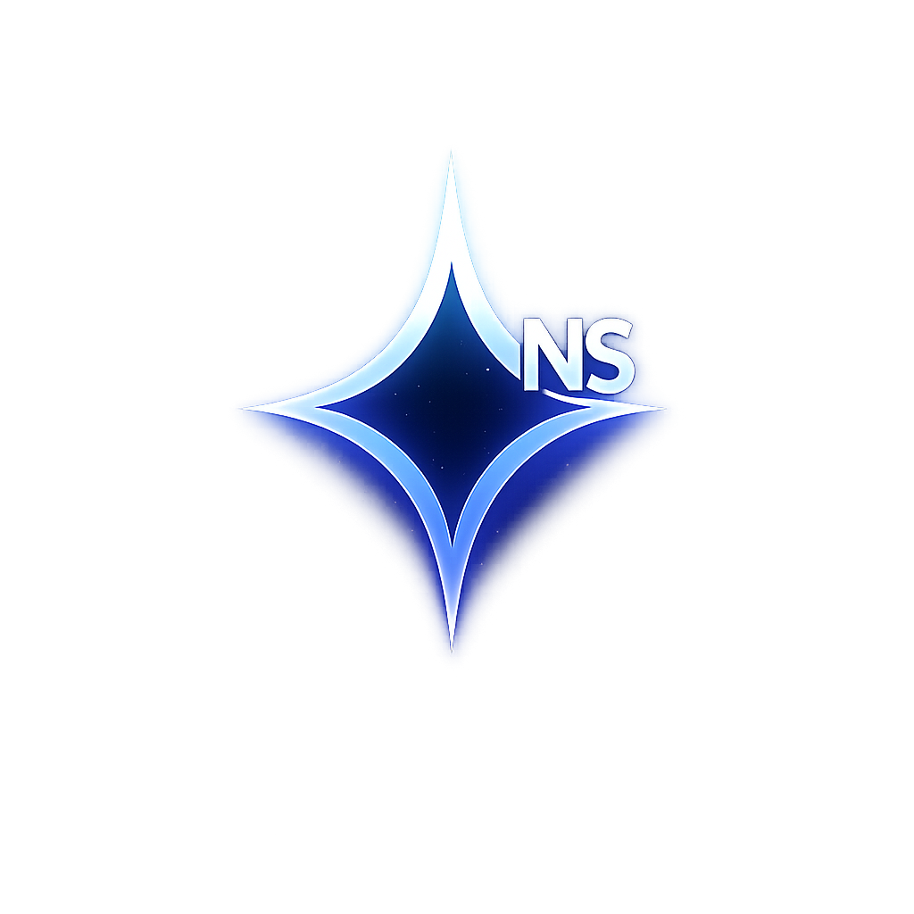

<p align="center">
  
</p>

# Northstar One: Brand New Light

A PyQt6 / QWebEngine browser with a glassmorphic dark UI, a custom new tab
page, a sidebar-based tab list, and a built-in AI assistant.

> **Status: work in progress.** This README describes what the code
> actually does today. Sections marked *experimental* are not wired into the
> browser UI yet, and they are called out rather than presented as features.

---

## Features

### Working

- **Custom new tab page** with quick-dial bookmark tiles, a wallpaper
  background and a rotating wallpaper carousel.
- **Sidebar tab list** — each tab is rendered as a `TabCard` widget in the
  left sidebar. The native Qt tab bar is hidden, so this list *is* the tab
  strip. There is no tab-overview grid.
- **Bookmarks** — bookmarks bar, new-tab tile editor, and one-shot import
  from **Chrome, Edge, Firefox, Brave, Vivaldi and Opera** (including
  Firefox's `places.sqlite`). There is no standalone bookmark-manager
  window; management happens in the bookmarks bar and the new-tab tiles.
- **Leo AI assistant** — a docked side panel that talks to **Ollama** (local,
  `http://localhost:11434`), **OpenAI**, or **Groq**. Keys are saved through
  the OS keyring.
- **Password book** — master-password gate, search, lock/unlock and autofill,
  with entries stored in the OS keyring. Open it from the 🔑 button in the
  sidebar, or with `Ctrl+Shift+K`. It is one of the panels that **stays open
  when you click elsewhere** on the page — close it with the 🔑 sidebar
  button or the 🔒 lock button inside the panel.
- **Search engine selector** — Google, DuckDuckGo, Bing, Brave or Ecosia.
  The default is **Google**.
- **Settings page** (`northstar://settings`) — search engine, toolbar mode
  (hover / always / address), OLED mode, background style, wallpaper mode,
  colours and typography.
- **History, downloads, find-in-page, zoom, fullscreen, picture-in-picture**,
  a command palette, a notes page and an extensions page.

### Sidebar

The left sidebar holds the tab list. Its bottom button row opens:

| Button | Opens | Shortcut |
|---|---|---|
| ✦ | Leo AI panel | `Ctrl+Shift+A` |
| ⬇ | Downloads | `Ctrl+J` |
| 📝 | Notes | - |
| 🕐 | History | `Ctrl+H` |
| 🔑 | Password Book | `Ctrl+Shift+K` |
| ✦⇄ | StarShare | `Ctrl+Shift+S` |
| ⚙ | Settings | `Ctrl+,` |
| ⌘ | Command Palette | `Ctrl+P` |

### Not finished / misleading if you read the code at face value

- **No light theme.** Light mode was removed from the codebase; the app is
  dark-only with an optional OLED palette.
- **No API-key section in the settings page.** Leo's keys live in a separate
  *Leo AI Settings* dialog.
- **Firecrawl enrichment produces data that is never shown.** The pipeline
  runs and builds a `PageProfile` (title, description, markdown, hero image),
  but the completion callback only writes a log line — there is no preview UI
  wired up yet.
- **`legacy/experimental_search/` is dead code.** The old Opal Discovery /
  NSIndex search stack is unreachable from the browser UI: its only entry
  point, `northstar://search?q=`, is itself only ever generated from inside
  the Opal page, so it can never be reached from a cold start. It is kept in
  `legacy/` for reference only — **do not treat it as a feature.** The single
  exception is the omnibox URL heuristic (`_is_url` / `format_url`) in
  `legacy/experimental_search/northstar_search.py`, which the address bar
  still calls.
- **NSIndex's crawler, indexer, BM25 and storage layers are never
  instantiated** by the browser, and `index_visited_page()` is never called,
  so the adaptive index stays empty.
- **Wallpapers are not shipped in this repository.** `assets/wallpapers/` and
  `assets/wallpaper_videos/` are gitignored (only `.gitkeep` is tracked), so
  a fresh clone falls back to the built-in constellation gradient. Drop your
  own images in those folders to use the wallpaper features.

---

## Requirements

- Python 3.10+ (developed against 3.14)
- PyQt6 6.8+ and PyQt6-WebEngine 6.8+

Install everything with either of these:

```bash
pip install -r requirements.txt
# or
python dependency_manager.py
```

| Package | Why |
|---|---|
| `PyQt6`, `PyQt6-WebEngine` | UI and rendering engine |
| `requests` | HTTP calls |
| `Pillow` | favicon / image handling |
| `keyring` | **Optional** — Password Book and Leo API keys. Without it, writes are silent no-ops and nothing persists between runs. |
| `duckduckgo_search` | **Optional** — experimental search providers |
| `firecrawl` | **Optional** — content enrichment |

> The Password Book stores entries in the OS keyring *unencrypted*; the
> master password is a UI gate, not a vault encryption key.

---

## Quick Start

```bash
pip install -r requirements.txt
python NorthStar_v1.py
```

Settings, bookmarks, history and the password book are stored in
`%APPDATA%\NorthStar` on Windows.

---

## Environment Variables

`.env` is read by `legacy/experimental_search/northstar_search.py` when that
module is imported. Copy `.env.example` to `.env` to configure it.

| Variable | Description |
|----------|-------------|
| `FIRECRAWL_API_KEY` | Firecrawl key for the content-enrichment provider |
| `BRAVE_SEARCH_API_KEY` | Brave Search key for the experimental Brave provider (no UI field) |
| `SERPAPI_API_KEY` | SerpAPI key for the experimental SerpAPI provider |
| `NS_DEBUG` | Debug logging. **Must be exported in your shell** (`set NS_DEBUG=1`) — the browser reads it at startup, before `.env` is loaded. |

---

## Keyboard Shortcuts

| Shortcut | Action |
|----------|--------|
| `Ctrl+T` | New tab |
| `Ctrl+Shift+T` | Reopen closed tab |
| `Ctrl+W` | Close tab |
| `Ctrl+R` / `Ctrl+Shift+R` | Reload / hard reload |
| `Ctrl+L` | Focus address bar |
| `Alt+Left` / `Alt+Right` | Back / forward |
| `Ctrl+D` | Toggle bookmark |
| `Ctrl+Shift+A` | Toggle Leo AI panel |
| `Ctrl+Shift+K` | Toggle password book |
| `Ctrl+H` | Toggle history |
| `Ctrl+J` | Toggle downloads |
| `Ctrl+F` | Find in page |
| `Ctrl+Shift+S` | StarShare |
| `Ctrl+,` | Settings |
| `Ctrl+P` | Command palette |
| `Ctrl+Shift+P` | Picture-in-picture |
| `Ctrl+`+`/`Ctrl+=` | Zoom in |
| `Ctrl+-` | Zoom out |
| `Ctrl+0` | Reset zoom |
| `F11` | Fullscreen |
| `Escape` | Dismiss overlay |

---

## Project Layout

```
NorthStar_v1.py          Main application (UI, tabs, settings, new tab page)
oled_theme.py            OLED palette and theme tokens
fernway_manager.py       Persistent settings store
ai_manager.py            Ollama / OpenAI / Groq providers
bg_render.py             Background renderer
extensions.py            Extension manager
content/                 Content-enrichment pipeline (Firecrawl provider)
legacy/                 Dead code kept for reference - not part of the browser
  experimental_search/   Old Opal Discovery + NSIndex search stack
tests/                   Unit tests
```

---

## Tests

```bash
python -m unittest discover -s tests -v
```

---

## License

MIT — see [LICENSE](LICENSE).
